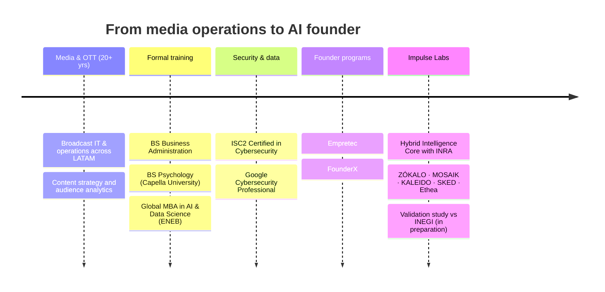

# Giovanni Oliveira · Hybrid Intelligence

**Founder of Impulse Labs** · Global MBA in AI & Data Science · BS Psychology · 20+ years in media/OTT across LATAM · Mexico City

---

## 👋 About

I build **Hybrid Intelligence**: AI that lets an organization hear how real people would react to a message *before* it goes public.

Language models alone mostly speak with the voice of the US and of highly educated users. My work anchors them in Mexico: every simulated person is drawn from the **2020 Census** and grounded in a **real face-to-face interview by INRA**, our field-research partner. Each reading reports its own limits and every product cites the science it rests on.

What I bring is the mix: two decades running broadcast and OTT operations, formal training in **AI & data science** and **psychology**, and a founder's discipline sharpened in **Empretec** and **FounderX**. I design the product, define the science behind it, and ship it with AI as my engineering partner.

> *Inteligencia Híbrida: escuchar cómo reaccionaría la gente real antes de hablar. · Inteligência Híbrida: ouvir como pessoas reais reagiriam antes de falar.*

---

## 🚀 What I'm Building · Impulse Labs

| | | | | |
|:---:|:---:|:---:|:---:|:---:|
| **ZÓKALO** | **MOSAIK** | **KALEIDO** | **SKED** | **Ethea** |
| Hybrid Intelligence Core | Hybrid Intelligence Core | Hybrid Intelligence Core | Impulse Labs | Impulse Labs |

**The Hybrid Intelligence Core** is one engine shared by several products:

- **Silicon samples anchored in Mexico**: census-based probability sampling with design weights, plus donor imputation from INRA interviews under k-anonymity.
- **Rigor by design**: paired A/B tests with confidence intervals and minimum detectable effect, A/A controls, answer-order reversal against LLM position bias, fixed seeds and a method card per run.
- **Honest about limits**: a *Scientific Basis* module in every product, with 20+ academic references and the literature's known failure modes.
- **Validation in the open**: a study in preparation for a peer-reviewed journal tests the method against official INEGI surveys, with pre-registered forecasts and a memorization probe.
- **Production-minded**: reproducible byte-identical builds, golden-hash regression tests, multi-provider LLM gateway (Anthropic API / Amazon Bedrock / Vertex AI) with per-organization quotas and metering.

➡️ **[Read the method and the build log](hybrid-intelligence/README.md)**

All products are private and in active development with partners. Data, clients and product internals are not published here.

**How I build:** product spec and science first → AI-assisted engineering (Claude, Lovable) → automated tests and reproducible builds → human review before every deploy.

<b>AI & product stack</b>

 

---

## 🧭 Founder Track

---

## 📂 Public Portfolio

Open-source projects that show the building blocks behind Hybrid Intelligence: NLP, audience analytics and applied psychology.

| Project | What it shows | Stack |
|:---|:---|:---|
| [**Content Psychology Analyzer**](https://github.com/Neckr0ik/content-psychology-analyzer) | Scores media content on 7 psychological engagement dimensions (Seligman PERMA, Loewenstein, Russell, Green & Brock) | Python · NLP |
| [**Phishing Psychology Analyzer**](https://github.com/Neckr0ik/phishing-psychology-analyzer) | Maps social-engineering text to the cognitive biases it exploits (Kahneman, Cialdini, MITRE ATT&CK) | Python · VADER |
| [**News Sentiment Analyzer**](https://github.com/Neckr0ik/news-sentiment-analyzer) | Topic-level sentiment over live RSS feeds for multi-source newsrooms | Python · NLP · RSS |
| [**Content Analytics Dashboard**](https://github.com/Neckr0ik/content-analytics-dashboard) | Audience growth, slot/genre analysis and content ROI for broadcast & OTT | Pandas · Seaborn |
| [**YouTube Revenue Simulator**](https://github.com/Neckr0ik/youtube-revenue-simulator) | Channel growth, CPM/RPM dynamics and monetization milestones across niches | NumPy · Matplotlib |

---

## 🛡️ Foundations · Security, GRC & Data Protection

Responsible AI starts with secure systems and protected data. This repository keeps my hands-on security and governance work:

<b>Explore the foundations</b>

 

| Area | Contents |
|:---|:---|
| [Network Defense](1-Cybersecurity/1.1-Network-Defense) | Scapy packet sniffer, Wazuh SIEM queries, tcpdump incident analysis |
| [System Hardening](1-Cybersecurity/1.2-System-Hardening) | STIG/CIS Linux hardener, Linux permissions lab, Botium Toys security audit |
| [Incident Response](1-Cybersecurity/1.3-Incident-Response) | NIST-based playbooks (phishing, malware, data breach, intrusion), incident journal, Slack remediation bot |
| [Cloud Engineering](2-Cloud-Engineering/2.1-Infrastructure-as-Code) | Secure Azure blueprint in Terraform |
| [Data Protection & Log Analysis](3-Data-Analytics) | SQL-injection defence playground, auth-log parser, Nmap bulk reporter |
| [Human Factors](4-Psychology) | Social-engineering analysis and security-awareness design |
| [GRC](5-Business-Admin) | Policy framework (AUP, access control, IR policy) and FMEA-based risk assessment |

---

## 🎓 Credentials

| AI, Data & Business | Security | Psychology |
|:---|:---|:---|
| Global MBA — AI & Data Science (ENEB) | ISC2 Certified in Cybersecurity (CC) | BS Psychology (Capella University) |
| BS Business Administration (UoPeople) | Google Cybersecurity Professional Certificate | Applied: I-O, social, cognitive & positive psychology |
| IBM Data Science Professional (in progress) | | |
| Empretec · FounderX · Six Sigma White Belt | | |

---

## 🤝 Let's Talk

Open to **AI product partnerships, pilots with media and communication teams, and senior AI/data strategy roles**.

Code in this repository is MIT-licensed · [Ethics statement](docs/ETHICS.md) · [Security policy](docs/SECURITY.md)

