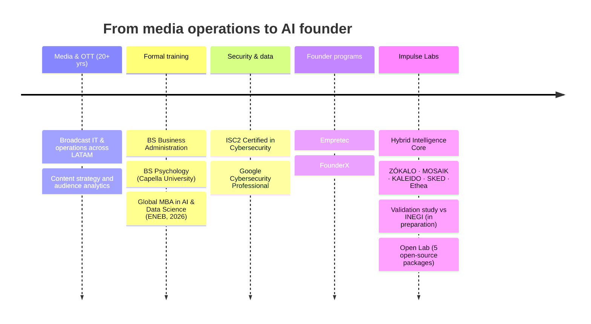

# Digital Forge 锻

### 👋 Welcome to the Digital Forge

*Forging Hybrid Intelligence at the intersection of AI, audiences and human psychology.*

Giovanni Oliveira · Impulse Labs · Mexico City · ES · PT · EN

---

## 👋 About

I build **Hybrid Intelligence**: AI that simulates how a census-anchored audience might react to a message *before* it goes public, to anticipate objections and compare wordings.

Language models alone mostly speak with the voice of the US and of highly educated users. My work anchors them in Mexico: every simulated person is drawn from the **2020 Census** and enriched with private field data, developed with **INRA**. Each reading reports its own limits and cites the science it rests on.

> It is a simulation, not a survey: no output is a measure of public opinion or voting intention.

What I bring is the mix: two decades running broadcast and OTT operations, formal training in **AI & data science** and **psychology**, and a founder's discipline sharpened in **Empretec** and **FounderX**. I design the product, define the science behind it, and ship it with AI as my engineering partner.

> *Inteligencia Híbrida: simular cómo podría reaccionar una audiencia anclada en el Censo antes de hablar. · Inteligência Híbrida: simular como uma audiência ancorada no Censo poderia reagir antes de falar.*

---

## 🚀 What I'm Building · Impulse Labs

| | | | | |
|:---:|:---:|:---:|:---:|:---:|
| **ZÓKALO** | **MOSAIK** | **KALEIDO** | **SKED** | **Ethea** |
| Hybrid Intelligence Core | Hybrid Intelligence Core | Hybrid Intelligence Core | Impulse Labs | Impulse Labs |

**The Hybrid Intelligence Core** is one engine shared by several products:

- **Silicon samples anchored in Mexico**: census-based probability sampling with design weights, enriched with private field data under k-anonymity.
- **Rigor by design**: paired A/B tests with confidence intervals and minimum detectable effect, A/A controls, answer-order reversal against LLM position bias, fixed seeds and a method card per run.
- **Honest about limits**: a *Scientific Basis* module in each of the three core products, citing the literature and its known failure modes ([summary and references](hybrid-intelligence/README.md#references)).
- **Validation, planned in the open**: a study in preparation will test the method against official INEGI surveys, with forecasts registered before each official release and a memorization probe. The harness is public: [silicon-sample-validation](open-lab/silicon-sample-validation).
- **Production-minded**: reproducible builds checked by golden-hash regression tests, and a multi-provider LLM gateway (Anthropic API / Amazon Bedrock) with per-organization quotas and metering; the [open gateway](open-lab/llm-gateway-metering) adds Vertex AI.

➡️ **[Read the method and the build log](hybrid-intelligence/README.md)**

All products are private and in active development. Data, clients and product internals are not published here.

**How I build:** product spec and science first → AI-assisted engineering (Claude, Lovable) → automated tests and reproducible builds → human review before every deploy.

---

## 🧪 Open Lab · Hybrid Intelligence in the open

Five open-source packages that rebuild the **public foundations** of the method with public INEGI data only. They show how the core thinks without exposing products, clients or interviews. **[Explore the Open Lab →](open-lab/README.md)**

| Package | What it answers | Data |
|:---|:---|:---|
| [**mx-census-sampler**](open-lab/mx-census-sampler) | *Who is in the sample?* PPS sampling of Mexico's 2,469 municipalities with census-anchored profiles, design weights and Kish effective n | Censo 2020 (ITER) |
| [**endutih-media-profiles**](open-lab/endutih-media-profiles) | *How do they consume media?* Weighted internet, social-network, streaming, radio and open-TV use by state, sex, age and urban/rural | ENDUTIH 2025 |
| [**llm-survey-bias-kit**](open-lab/llm-survey-bias-kit) | *Is the simulated reading trustworthy?* Answer-order bias, paired A/B with MDE, A/A noise floor, homogeneity checks | Your runs |
| [**silicon-sample-validation**](open-lab/silicon-sample-validation) | *Does it match reality?* Hash-chained pre-registered forecasts, training-cutoff guard, no-LLM baselines, memorization probe | Official surveys |
| [**llm-gateway-metering**](open-lab/llm-gateway-metering) | *Can it run as a SaaS?* Anthropic API · Bedrock · Vertex behind one gateway with org quotas and metering | — |

292 tests (289 run offline in CI; 3 need the optional Anthropic SDK or a live key) · CI on Python 3.11 and 3.12 · MIT

<b>AI & product stack</b>

 

---

## 🧭 Founder Track

---

## 📂 Public Portfolio

Open-source projects that show the building blocks behind Hybrid Intelligence: NLP, audience analytics and applied psychology.

| Project | What it shows | Stack |
|:---|:---|:---|
| [**News Sentiment Analyzer**](https://github.com/Neckr0ik/news-sentiment-analyzer) | Headline sentiment by source and topic for **English, Spanish and Portuguese** feeds, including Mexican outlets; VADER, offline es/pt lexicon or optional Claude API | Python · NLP · Claude API |
| [**Content Psychology Analyzer**](https://github.com/Neckr0ik/content-psychology-analyzer) | Scores media copy on 7 psychological engagement dimensions and **compares two framings of the same message** (Chong & Druckman, 2007) | Python · NLP |
| [**Phishing Psychology Analyzer**](https://github.com/Neckr0ik/phishing-psychology-analyzer) | Maps social-engineering wording to the cognitive biases it exploits, with a persuasion-pressure score and ATT&CK context | Python · VADER |
| [**Content Analytics Dashboard**](https://github.com/Neckr0ik/content-analytics-dashboard) | Broadcast & OTT analytics: growth by 12-month period, scheduling heatmap, genre and platform mix, content cost-efficiency | Pandas · Seaborn |
| [**YouTube Revenue Simulator**](https://github.com/Neckr0ik/youtube-revenue-simulator) | Channel growth, YPP eligibility and ad/sponsorship/membership revenue with same-channel niche comparison | NumPy · Matplotlib |

Every portfolio repo ships offline tests and CI on Python 3.11 and 3.12.

---

## 🛡️ Foundations · Security, GRC & Data Protection

Responsible AI starts with secure systems and protected data. This repository keeps my hands-on security and governance work:

<b>Explore the foundations</b>

 

| Area | Contents |
|:---|:---|
| [Network Defense](1-Cybersecurity/1.1-Network-Defense) | Scapy packet sniffer, Wazuh SIEM queries, tcpdump incident analysis |
| [System Hardening](1-Cybersecurity/1.2-System-Hardening) | STIG/CIS Linux hardener, Linux permissions lab, Botium Toys security audit |
| [Incident Response](1-Cybersecurity/1.3-Incident-Response) | NIST-based playbooks (phishing, malware, data breach, intrusion), incident journal, Slack remediation bot |
| [Cloud Engineering](2-Cloud-Engineering/2.1-Infrastructure-as-Code) | Secure Azure blueprint in Terraform |
| [Data Protection & Log Analysis](3-Data-Analytics) | SQL-injection defence playground, auth-log parser, Nmap bulk reporter |
| [Human Factors](4-Psychology) | Social-engineering analysis and security-awareness design |
| [GRC](5-Business-Admin) | Policy framework (AUP, access control, IR policy) and FMEA-based risk assessment |

---

## 🎓 Credentials

| AI, Data & Business | Security | Psychology |
|:---|:---|:---|
| Global MBA — AI & Data Science (ENEB, 2026) | ISC2 Certified in Cybersecurity (CC) | BS Psychology (Capella University) |
| BS Business Administration (UoPeople) | Google Cybersecurity Professional Certificate | Applied: I-O, social, cognitive & positive psychology |
| IBM Data Science Professional (in progress) | | |
| Empretec · FounderX · Six Sigma White Belt | | |

---

## 🤝 Let's Talk

Open to **AI product partnerships, pilots with media and communication teams, and senior AI/data strategy roles**.

Code in this repository is MIT-licensed; INEGI-derived data under INEGI's free-use terms · [Ethics statement](docs/ETHICS.md) · [Security policy](docs/SECURITY.md)

*"In the forge of digital transformation, we shape tools that serve humanity."*

