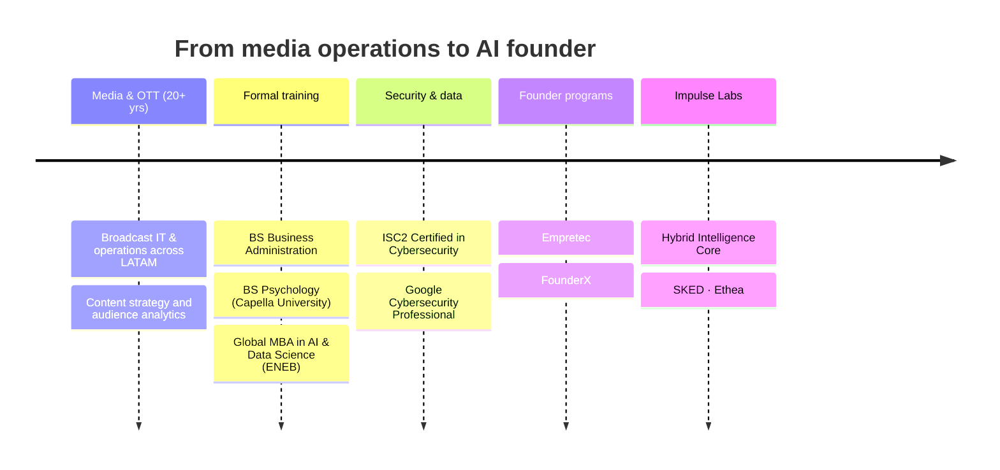

# Giovanni Oliveira · AI Builder & Founder

**Founder of Impulse Labs** · Global MBA in AI & Data Science · 20+ years in media/OTT across LATAM · Mexico City

---

## 👋 About

I build **AI products that help organizations make decisions about people and messages** — newsrooms, brands, public-communication teams and individuals.

My edge is the combination nobody else on the team has to bring: two decades running broadcast and OTT operations, formal training in **AI & data science** and **psychology**, and a founder's discipline sharpened in **Empretec** and **FounderX**. I design the product, define the science behind it, and ship it with AI as my engineering partner.

> *Construyo productos de IA para decidir mejor sobre personas y mensajes. · Construo produtos de IA para decidir melhor sobre pessoas e mensagens.*

---

## 🚀 What I'm Building · Impulse Labs

**Hybrid Intelligence Core** — one shared engine (simulation, scientific grounding, multi-provider LLM layer) powering several vertical products. Most of this work is private because it carries client and proprietary research data; below is what can be shared.

| Product | What it does | Status |
|:---|:---|:---|
| **Hybrid Intelligence Core** | Shared engine behind vertical products for public-affairs communication and brand message testing: audience simulation grounded in census and official data, a "scientific basis" layer, and an LLM gateway (Anthropic API / Amazon Bedrock / Vertex AI) with usage metering and per-org quotas | Working prototypes · private |
| **SKED** | Assistant for a newsroom's head of information: reads incoming sources, builds the rundown (*sked*) and weights it against the outlet's audience data | Prototype · private |
| **Ethea** | Personality-insight platform with forced-choice tests (lower bias than agreement scales), multilingual (ES · PT · EN · FR), science notes on every test and a B2B track for coaches and HR | In development · private |

**How I build:** product spec and science first → AI-assisted engineering (Claude, Lovable) → automated tests and reproducible builds → human review before every deploy.

<b>AI & product stack</b>

 

---

## 🧭 Founder Track

---

## 📂 Public Portfolio

Open-source projects that show the building blocks behind the products: NLP, audience analytics and applied psychology.

| Project | What it shows | Stack |
|:---|:---|:---|
| [**Content Psychology Analyzer**](https://github.com/Neckr0ik/content-psychology-analyzer) | Scores media content on 7 psychological engagement dimensions (Seligman PERMA, Loewenstein, Russell, Green & Brock) | Python · NLP |
| [**Phishing Psychology Analyzer**](https://github.com/Neckr0ik/phishing-psychology-analyzer) | Maps social-engineering text to the cognitive biases it exploits (Kahneman, Cialdini, MITRE ATT&CK) | Python · VADER |
| [**News Sentiment Analyzer**](https://github.com/Neckr0ik/news-sentiment-analyzer) | Topic-level sentiment over live RSS feeds for multi-source newsrooms | Python · NLP · RSS |
| [**Content Analytics Dashboard**](https://github.com/Neckr0ik/content-analytics-dashboard) | Audience growth, slot/genre analysis and content ROI for broadcast & OTT | Pandas · Seaborn |
| [**YouTube Revenue Simulator**](https://github.com/Neckr0ik/youtube-revenue-simulator) | Channel growth, CPM/RPM dynamics and monetization milestones across niches | NumPy · Matplotlib |

---

## 🛡️ Foundations · Security, GRC & Data Protection

Responsible AI starts with secure systems and protected data. This repository keeps my hands-on security and governance work:

<b>Explore the foundations</b>

 

| Area | Contents |
|:---|:---|
| [Network Defense](1-Cybersecurity/1.1-Network-Defense) | Scapy packet sniffer, Wazuh SIEM queries, tcpdump incident analysis |
| [System Hardening](1-Cybersecurity/1.2-System-Hardening) | STIG/CIS Linux hardener, Linux permissions lab, Botium Toys security audit |
| [Incident Response](1-Cybersecurity/1.3-Incident-Response) | NIST-based playbooks (phishing, malware, data breach, intrusion), incident journal, Slack remediation bot |
| [Cloud Engineering](2-Cloud-Engineering/2.1-Infrastructure-as-Code) | Secure Azure blueprint in Terraform |
| [Data Protection & Log Analysis](3-Data-Analytics) | SQL-injection defence playground, auth-log parser, Nmap bulk reporter |
| [Human Factors](4-Psychology) | Social-engineering analysis and security-awareness design |
| [GRC](5-Business-Admin) | Policy framework (AUP, access control, IR policy) and FMEA-based risk assessment |

---

## 🎓 Credentials

| AI, Data & Business | Security | Psychology |
|:---|:---|:---|
| Global MBA — AI & Data Science (ENEB) | ISC2 Certified in Cybersecurity (CC) | BS Psychology (Capella University) |
| BS Business Administration (UoPeople) | Google Cybersecurity Professional Certificate | Applied: I-O, social, cognitive & positive psychology |
| IBM Data Science Professional (in progress) | | |
| Empretec · FounderX · Six Sigma White Belt | | |

---

## 🤝 Let's Talk

Open to **AI product partnerships, pilots with media and communication teams, and senior AI/data strategy roles**.

Code in this repository is MIT-licensed · [Ethics statement](docs/ETHICS.md) · [Security policy](docs/SECURITY.md)

