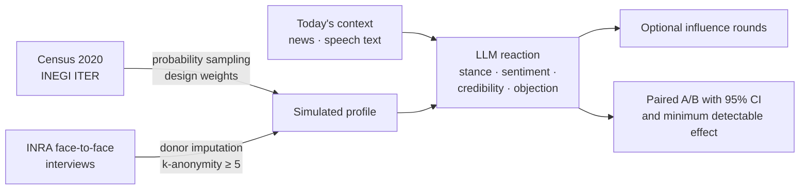

# Hybrid Intelligence · Method & Build Log

*Impulse Labs · powered by INRA field research*

**Hybrid Intelligence** is the shared core behind Impulse Labs' products. It combines three things that are rarely in the same room: **official census data**, **real face-to-face interviews by INRA**, and **large language models**. The result is a *silicon sample*: a population of simulated people, each one anchored in a real Mexican profile, that reacts to a message before it goes public.

It is built to **anticipate objections, compare wordings and generate hypotheses**. It is not a poll, does not estimate voting intention and does not forecast sales; every product says so on screen.

---

## How a reading is built

| Step | What happens | Grounded in |
|:---|:---|:---|
| Census sampling | Municipalities drawn proportional to adult population; traits from Census 2020 cells; design weights and effective sample size reported | Kish (1965) |
| A real person behind each profile | Life and media context taken from an INRA interview with the same profile | Hot-deck imputation (Andridge & Little, 2010) · Argyle et al. (2023) · k-anonymity (Sweeney, 2002) |
| Context of the moment | Profiles react with the day's information | Social impact theory (Latané, 1981) |
| Reaction | The model answers *as that person*, within the limits of their data; answer order reversed in half the batches to cancel position bias | Algorithmic fidelity (Argyle et al., 2023) · Dominguez-Olmedo et al. (2024) |
| Influence rounds | Profiles see each other's stances and may change; who moved whom is logged | Latané (1981) · Moscovici et al. (1969) · Centola (2010) · Sunstein (2002) |
| A/B comparison | Paired per profile, replicated, order alternated; "indistinguishable" unless it beats the minimum detectable effect; A/A control | Ashokkumar et al. (2026) |

## Known limits, stated up front

Every product ships a **Scientific Basis** tab that lists what the literature says this method *cannot* do and how the tool handles it: simulated answers that are too homogeneous (Bisbee et al., 2024), models that represent the US and highly educated profiles better than others (Santurkar et al., 2023; Durmus et al., 2023; Atari et al., 2023), memorization of published polls (Kozlowski & Evans, 2025), inflated effect sizes (Ashokkumar et al., 2026) and the gap between a realistic simulation and a calibrated estimator (Hullman et al., 2026).

## Validation study · in preparation

The method's fidelity with the **Mexican population has not been measured yet**. A study in preparation for a peer-reviewed journal tests it against official INEGI surveys:

1. How close do simulated people get to the perception official surveys measure, by state and city?
2. Do they beat simple baselines that need no language model?
3. Does anchoring each person in a real interview beat describing them with demographics alone?
4. Where does it fail: region, urbanization, indigenous-language presence, opinion dispersion?

Safeguards: compare only against figures published after the model's training cutoff, register forecasts before the official release, run a memorization probe, and report negative results with open code and seeds. The harness is already open: [silicon-sample-validation](../open-lab/silicon-sample-validation).

---

## Products on the core

**ZÓKALO** · **MOSAIK** · **KALEIDO** — built on the Hybrid Intelligence Core.
**SKED** · **Ethea** — sister products from Impulse Labs.

All are private and in active development with partners.

---

## Build log

| Date | Milestone |
|:---|:---|
| 2026-10-13 | **Open Lab** published: census sampler, ENDUTIH 2025 media profiles, LLM survey bias kit, validation harness and LLM gateway with metering — public data only, 224 offline tests ([open-lab](../open-lab/README.md)) |
| 2026-10-12 | **Ethea**: redesign, new tests, French language, science notes per test and B2B track |
| 2026-10-11 | Shared **Scientific Basis** module shipped in all three core products: method, evidence, limits and 20+ academic and official references, written once and rendered per brand |
| 2026-10-10 | **Core under version control**: one engine, three products, byte-identical reproducible builds and golden-hash regression tests for the sampler (fixed seed) |
| 2026-10-10 | **Core server v0**: run the products as a web app outside the chat interface, with accounts, a shared monthly quota per organization, per-user metering, run history in PostgreSQL and a switchable LLM provider (Anthropic API / Amazon Bedrock) |
| 2026-10-10 | **SKED** under version control |
| Next | One-command deploy with backup and rollback · split the shared engine into modules · validation study fieldwork |

Log entries describe engineering milestones only. Client data, interview content and product internals stay private.
