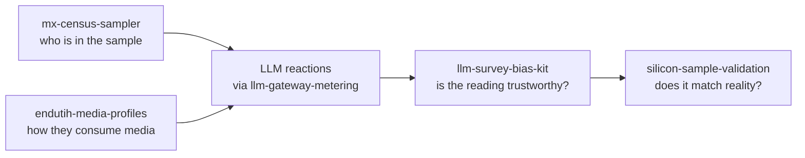

# Hybrid Intelligence · Open Lab

*Open-source building blocks behind Impulse Labs' Hybrid Intelligence. Public data only; no client data, interviews or product internals.*

> **Resumen:** herramientas abiertas que muestran la base del método de Inteligencia Híbrida: muestreo con el Censo 2020, perfiles de medios con la ENDUTIH 2025, análisis de sesgos de respuestas simuladas por IA, validación contra encuestas oficiales y una pasarela de modelos con cuotas por organización.

| Package | What it does | Data | Tests |
|:---|:---|:---|:---:|
| [**mx-census-sampler**](mx-census-sampler) | Reproducible PPS sampling of Mexico's 2,469 municipalities by adult population, census-anchored respondent profiles, design weights, Kish effective n | INEGI Censo 2020 (ITER) | 33 |
| [**endutih-media-profiles**](endutih-media-profiles) | Weighted media & technology use (internet, social networks, streaming, radio, open TV…) by state, sex, age and urban/rural, with design-based SE, Wilson CIs and small-cell plus complementary suppression | INEGI ENDUTIH 2025 | 19 |
| [**llm-survey-bias-kit**](llm-survey-bias-kit) | Diagnostics for LLM-simulated responses: answer-order bias, paired A/B with CI and minimum detectable effect, A/A noise floor, homogeneity vs human reference | Your CSVs | 87 |
| [**silicon-sample-validation**](silicon-sample-validation) | Pre-registration-friendly validation harness: hash-chained forecast registry, training-cutoff guard, no-LLM baselines, memorization probe, failure breakdown | Your estimates vs official figures | 86 |
| [**llm-gateway-metering**](llm-gateway-metering) | Multi-provider LLM gateway (Anthropic API · Amazon Bedrock · Vertex AI) with shared monthly quotas per organization, 80% warnings, per-user/feature metering, rate limits | — | 67 |



Each package is standalone (its own `pyproject.toml`, README, license and tests), Python 3.11+, and runs offline. CI runs every package on Python 3.11 and 3.12.

```bash
cd open-lab/mx-census-sampler
pip install -e . pytest
pytest -q
mx-census-sampler sample -n 400 --seed 2027
```

<sub>MIT © 2026 Giovanni Oliveira · INEGI data under INEGI's *Términos de libre uso de la información* · Part of [github.com/Neckr0ik](https://github.com/Neckr0ik)</sub>
