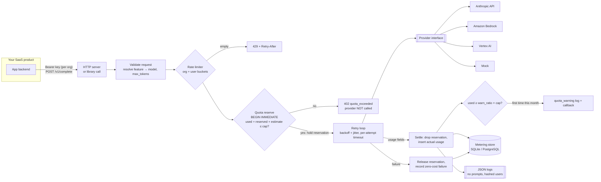

# llm-gateway-metering

> **Resumen (ES).** Un gateway pequeño para productos SaaS que atienden a organizaciones: una sola interfaz para Claude vía Anthropic API, Amazon Bedrock y Google Vertex AI (más un proveedor simulado para pruebas), con medición por organización, usuario y función, una cuota mensual compartida con tope duro y aviso al 80 %, límites de tasa, reintentos y registros JSON sin prompts ni datos personales.

A small, dependency-free (stdlib-only core) LLM gateway for multi-tenant SaaS. It sits between your product and the model provider and answers three questions on every request: *is this caller allowed right now* (rate limits), *can this organization afford it* (a monthly quota pool checked before the provider is called), and *what did it actually cost* (metering from the provider's own usage fields).

It reflects the production pattern behind the Impulse Labs products: one gateway in front of the models, every call attributed to an org, a user and a feature, and a budget that is enforced rather than reported after the fact. This repository is a clean-room, generic implementation of that pattern. It contains no product code or product logic.

Part of the Hybrid Intelligence open lab — https://github.com/Neckr0ik

---

## Features

- **One provider interface, four adapters:** Anthropic API, Amazon Bedrock (Mantle client), Google Vertex AI (Claude on Vertex), and a deterministic `mock` provider. The real SDKs are optional extras. You select the provider with an environment variable.
- **Metering:** every request is recorded with its org, user, feature, provider, served model, input and output tokens (plus cache read/write tokens), latency, attempts, status (`ok | refused | error | timeout`) and stop reason. Token counts come from the provider's `usage` fields.
- **Org quota pool:** all users of an org share one monthly pool (calendar month, UTC).
  - **Hard cap:** the gateway reserves a pessimistic estimate (estimated input + full `max_tokens`) *atomically* before calling the provider. If the reservation would cross the cap, the request is rejected and the provider is never called. After the call, the reservation is replaced by actual usage.
  - **Soft warning** at 80 % by default (configurable per org). It is flagged on every response past the threshold, logged once per org-month, and passed to an optional `on_warning` callback.
  - **Month rollover** happens implicitly, since usage is keyed by `YYYY-MM`. Earlier months stay queryable.
  - **Reports:** totals plus breakdowns by user, by feature and by model.
- **Rate limiting:** token buckets per org and per (org, user).
- **Retries** with exponential backoff and full jitter on retryable errors (429, 408/409, 5xx/529, connection errors, timeouts). `Retry-After` is honoured. The SDKs' own retries are disabled so each attempt is counted once, in one place.
- **Timeouts** apply per attempt.
- **Structured JSON logs** that never contain prompts or completions. User ids are pseudonymised by default, and credential-shaped strings are redacted.
- **Storage:** SQLite by default (stdlib `sqlite3`, WAL, `BEGIN IMMEDIATE`). The store interface is pluggable, and an optional PostgreSQL adapter is included.
- **Tiny HTTP server** (stdlib): `POST /v1/complete` and `GET /v1/usage`, with one API key per org.

## Architecture



### Why reservations?

A plain "read usage, then call" check races. Two concurrent requests can both read `used = 90 / 100` and both proceed. Instead, the gateway reserves the worst-case cost inside a write-locked transaction, so concurrent requests serialize on the quota decision and only the provider call runs in parallel. Reservations have a TTL (`reservation_ttl_s`, default 15 min), so a crashed worker can't leak budget forever. The tests run this race with threads on one store, with two separate store connections on one SQLite file (similar to two worker processes), and with 16 concurrent requests.

## Install

```bash
pip install .                 # core: stdlib only (mock provider, SQLite, server, CLI)
pip install ".[anthropic]"    # + Anthropic API
pip install ".[bedrock]"      # + Amazon Bedrock
pip install ".[vertex]"       # + Google Vertex AI
pip install ".[postgres]"     # + PostgreSQL store
pip install -e ".[test]" && pytest   # offline test suite
```

Python 3.11+.

## Configuration

Secrets come **only from environment variables**. Non-secret policy (orgs, quotas, features, rates) can live in a JSON file. See [`examples/gateway.example.json`](examples/gateway.example.json).

| Variable | Meaning | Default |
|---|---|---|
| `LLMGW_PROVIDER` | `mock` \| `anthropic` \| `bedrock` \| `vertex` | `mock` |
| `LLMGW_CONFIG_FILE` | path to the JSON policy file | – |
| `LLMGW_DEFAULT_MODEL` | model id used when a feature doesn't set one | `claude-sonnet-5-5` |
| `LLMGW_DB_PATH` | SQLite path, or `postgresql://…` URL | `llm_gateway.db` |
| `LLMGW_TIMEOUT_S` / `LLMGW_MAX_ATTEMPTS` | per-attempt timeout / total attempts | `60` / `3` |
| `LLMGW_DEFAULT_MONTHLY_LIMIT`, `LLMGW_WARN_RATIO` | pool for orgs not listed in the file | `1000000`, `0.8` |
| `LLMGW_API_KEYS` | `org:key,org:key` (hashed with SHA-256 on load) | – |
| `LLMGW_API_KEY_SHA256` | `org:<sha256 hex>,…` (pre-hashed; preferred) | – |
| `LLMGW_ANTHROPIC_FALLBACKS` | server-side refusal fallback on the Anthropic API | `true` |
| `LLMGW_LOG_LEVEL` | `DEBUG`…`ERROR` | `INFO` |
| `AWS_REGION` / `LLMGW_AWS_REGION` | Bedrock region (required for Bedrock) | – |
| `LLMGW_VERTEX_PROJECT` / `ANTHROPIC_VERTEX_PROJECT_ID` | GCP project (required for Vertex) | – |
| `LLMGW_VERTEX_REGION` / `CLOUD_ML_REGION` | Vertex region | `global` |

Provider credentials are resolved by each SDK in its standard way. The gateway never reads or stores them:

- **Anthropic API:** `ANTHROPIC_API_KEY` (or the SDK's other credential sources).
- **Bedrock:** the standard AWS chain (env vars, profile, instance/task role). Model ids are prefixed automatically: `claude-sonnet-5-5` → `anthropic.claude-sonnet-5-5`. Inference-profile ids and ARNs are passed through unchanged.
- **Vertex:** Google Application Default Credentials. Current models use the bare id (`claude-sonnet-5-5`).

**Quota units.** By default a quota counts tokens (input + output). To make output tokens count more, set `model_rates`, e.g. `{"default": {"input": 1, "output": 5}}`. The package deliberately ships no price list. Supply your own weights.

**Features** are the attribution dimension that matters most for product decisions. Each feature can set its own `model`, a `max_tokens` ceiling (callers can ask for less, never more) and an optional `effort` (sent as `output_config.effort`). With `strict_features: true`, unknown feature names are rejected.

## Usage

### As a library

```python
from llm_gateway_metering import CompletionRequest, FeatureConfig, Gateway, GatewayConfig, OrgConfig

gw = Gateway(GatewayConfig(
    provider="mock",                       # or "anthropic" | "bedrock" | "vertex"
    default_org=OrgConfig(monthly_limit=200_000, warn_ratio=0.8),
    features={"summarize": FeatureConfig(model="claude-haiku-5-5", max_tokens=512)},
))
r = gw.complete(CompletionRequest(
    org_id="acme", user_id="alice", feature="summarize",
    messages=[{"role": "user", "content": "Summarize: ..."}],
))
print(r.text, r.input_tokens, r.output_tokens, r.quota.remaining, r.quota.warning)
print(gw.usage_report("acme"))           # current month; usage_report("acme", "2026-09") for history
```

Errors are typed: `QuotaExceeded` (402), `RateLimited` (429, `.retry_after`), `InvalidRequest` (400), `ProviderTimeout` (504), `ProviderError` (502, `.retryable`, `.status_code`). [`examples/library_usage.py`](examples/library_usage.py) runs offline and shows the warning and the hard cap in action.

### CLI

```bash
export LLMGW_PROVIDER=mock LLMGW_CONFIG_FILE=examples/gateway.example.json
llm-gateway complete --org acme --user alice --feature chat --prompt "Hello"
llm-gateway usage --org acme [--period 2026-10]
echo -n "a-long-random-key" | llm-gateway hash-key          # → value for LLMGW_API_KEY_SHA256
LLMGW_API_KEY_SHA256="acme:<hash>" llm-gateway serve --host 127.0.0.1 --port 8080
```

### HTTP API

```bash
curl -s -X POST localhost:8080/v1/complete \
  -H "Authorization: Bearer $ACME_KEY" -H "Content-Type: application/json" \
  -d '{"user": "alice", "feature": "chat", "prompt": "Draft a status update", "max_tokens": 256}'
# → {"id", "text", "provider", "model", "stop_reason",
#    "usage": {"input_tokens", "output_tokens", "cost_units"},
#    "latency_ms", "attempts", "quota": {"period", "used", "limit", "remaining", "warning", ...}}

curl -s localhost:8080/v1/usage?period=2026-10 -H "Authorization: Bearer $ACME_KEY"
# → totals + by_user + by_feature + by_model for the caller's org
```

`messages` (a list of `{role, content}`) may be sent instead of `prompt`, along with an optional `system`. The org is always derived from the API key, never from the body. Status codes: 400 invalid, 401 bad or missing key, 402 quota exceeded, 429 rate limited (with `Retry-After`), 502 provider error, 504 provider timeout.

## Provider notes

- The default model is `claude-sonnet-5-5`, and it is configurable globally and per feature. Requests don't send sampling parameters or an explicit thinking config, because current Claude models reject non-default sampling values and run adaptive thinking by default. Use the per-feature `effort` to trade depth for cost.
- **Refusals:** a classifier decline arrives as HTTP 200 with `stop_reason: "refusal"`. It is metered with status `refused` and returned to the caller. On the **Anthropic API**, the gateway opts into server-side fallback by default (`fallbacks: "default"`, beta `server-side-fallback-2026-07-01`), so the API can re-run a declined request on Anthropic's recommended fallback model within the same call. When that happens, usage is summed across `usage.iterations` and the served model is recorded. Set `LLMGW_ANTHROPIC_FALLBACKS=false` to turn this off. Bedrock and Vertex don't offer server-side fallback, so refusals there are returned as-is.
- Non-streaming only. Keep feature `max_tokens` moderate, or add a streaming path if you need very long outputs.

## Security notes

- **Never log keys.** Logs are JSON events with ids, counts and timings only. Prompts, system prompts and completions are never passed to the logger. Error messages from providers are replaced with generic text (`provider returned HTTP 429`), because provider bodies can echo request content. A redaction filter scrubs strings that look like Anthropic keys, AWS access keys, bearer tokens and GCP access tokens, as a second line of defence.
- **Keys only via the environment.** Gateway API keys are read from `LLMGW_API_KEYS` / `LLMGW_API_KEY_SHA256`. The config loader *refuses* a JSON file that contains keys. Only SHA-256 digests are kept in memory, compared in constant time, and excluded from `repr`. Prefer the pre-hashed variable and long random keys. Provider credentials stay with the SDKs and their standard credential chains.
- **PII:** user ids are pseudonymised in logs (`u_<sha256 prefix>`, toggle `log_hash_user_ids`). The metering database *does* store raw user ids so it can produce per-user reports. Treat it as sensitive, and send it opaque ids rather than e-mail addresses where you can.
- The HTTP server has no TLS. Bind it to localhost or a private network and terminate TLS at a reverse proxy. Request bodies are capped at 1 MB. `serve` refuses to start without at least one API key.

## Limitations

- **Estimates are heuristics.** The pre-flight input estimate is about 4 characters per token, plus a flat guess for non-text blocks. Output is reserved at the full `max_tokens`. Real usage can exceed the input estimate slightly, so an org can end a month marginally over its cap. The output side can't overshoot. For tighter caps, swap in the provider's token-counting endpoint.
- **Rate limiting is in-process.** With several gateway processes, each has its own buckets. Put a shared limiter (e.g. Redis) behind the `RateLimiter` interface, or shard orgs across processes. Quotas *are* shared through the store.
- **SQLite** is fine for one host. It serializes quota decisions through a database write lock, which is simple and safe but limits write throughput. Use the PostgreSQL adapter (per-org-month advisory locks) for multiple hosts. That adapter is optional and **not covered by the offline tests**.
- Non-streaming completions only. No tool-use passthrough beyond what `messages` content blocks carry.
- No per-user sub-caps (the pool is per org). No billing or invoicing. No built-in prices.
- The HTTP server is deliberately minimal (stdlib `ThreadingHTTPServer`). It is not a substitute for an API gateway in front of it.

## Development

```bash
python -m venv .venv && . .venv/bin/activate
pip install -e ".[test]"          # the SDK extras are optional; adapter tests use fake clients
pytest -q
```

The test suite is fully offline. It uses the Mock provider and fake SDK clients that record request shapes, and covers the hard cap, the 80 % warning, month rollover, per-user and per-feature reports, the rate limiter, retries and backoff, timeouts, adapter request shaping and error mapping, the HTTP API, log hygiene, and concurrency safety of the quota check.

## License

MIT © 2026 Giovanni Oliveira. See [LICENSE](LICENSE).
